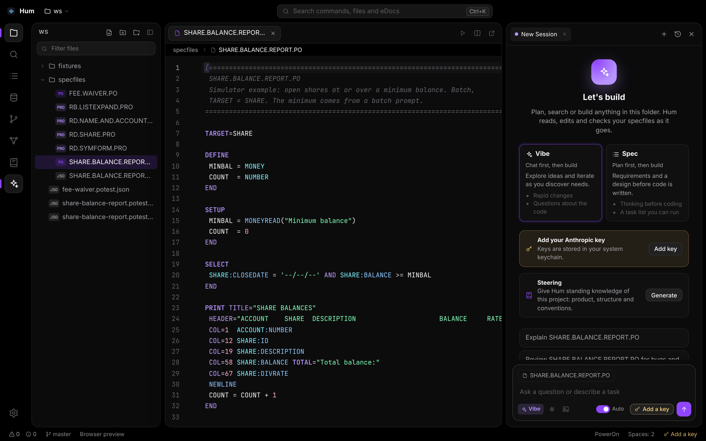
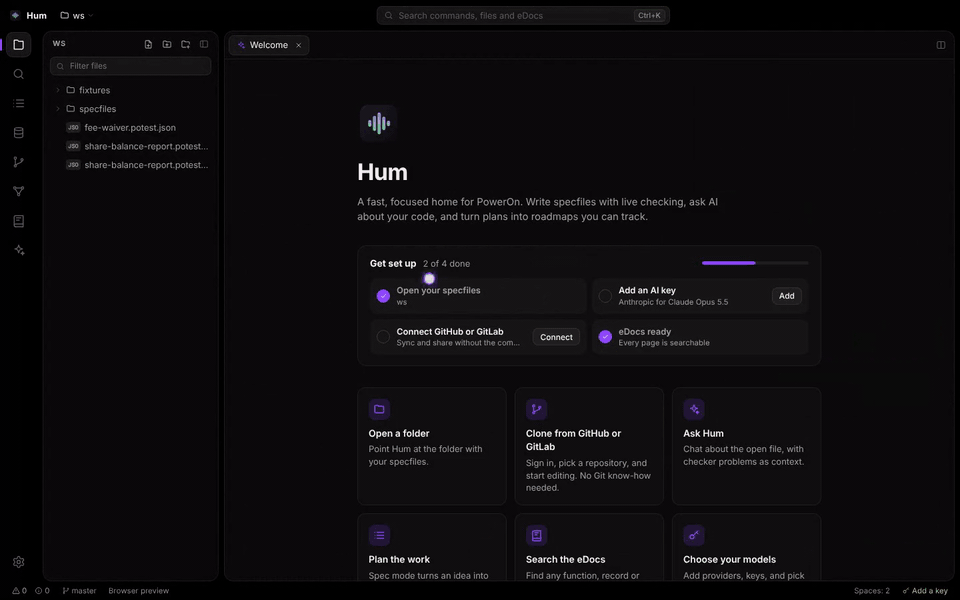
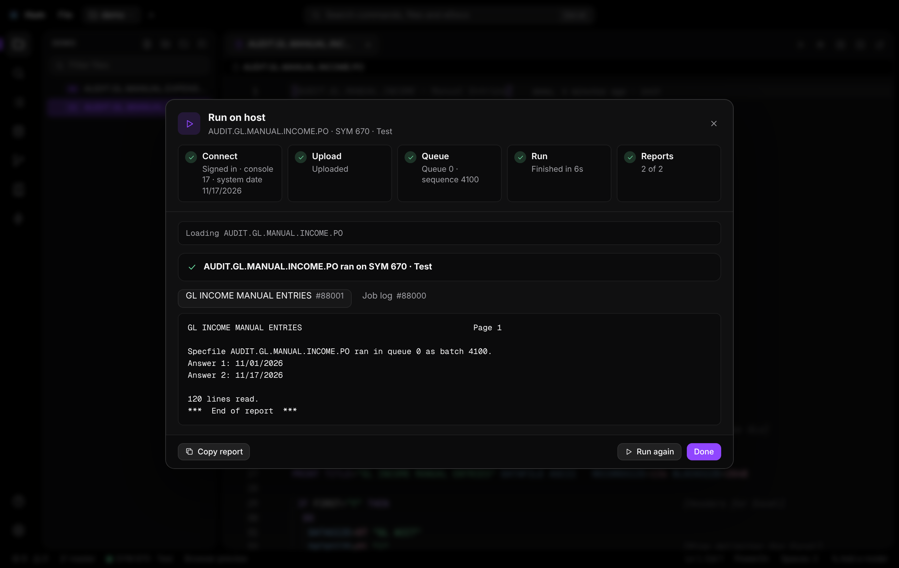
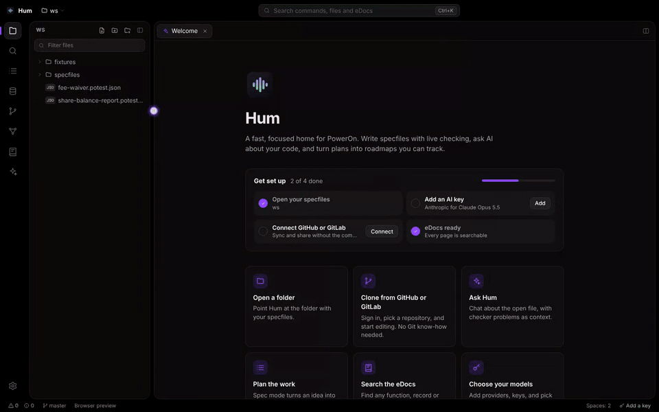
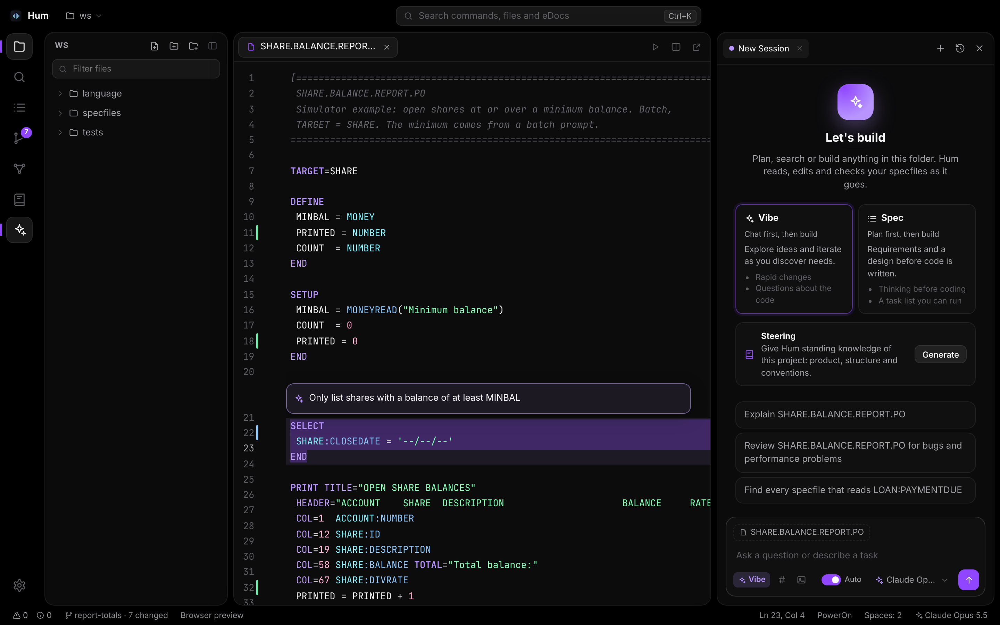

# Hum

Hum is a desktop editor for Symitar PowerOn. It checks specfiles as you type, has the eDocs built in, runs specfiles in a local simulator or on your Symitar host, and keeps your work in Git. It runs on macOS, Windows and Linux.

**[Download the latest release](https://github.com/TylerCodesTech/Hum-releases/releases/latest)** or see [Install](#install) for Homebrew and first-run notes.



## Why try it

PowerOn has no compiler outside the host, so the usual loop is edit, upload, run, read the error, repeat. Hum moves most of that loop onto your own computer.

- **You see errors before you upload.** A PowerOn checker runs on every keystroke and marks problems as syntax, type, semantic or style, many with a quick fix.
- **The eDocs are in the editor.** About 7,000 Symitar eDocs pages ship with the app. Hover a field or function to read its entry, or search every page from the same box you use to open files.
- **You can run a specfile without a SYM.** The simulator generates test accounts, asks the specfile's prompts and shows the report. It has breakpoints and stepping.
- **You can run it on the host when you are ready.** Run on host uploads the open specfile, answers its prompts, runs it in a batch queue and brings the reports back.
- **Your specfiles get version history.** Git is built in with nothing to install, and local history keeps earlier versions of every file you save even without Git.
- **AI is optional.** Ask Hum answers questions from the eDocs and your code with no model at all. If you want an AI agent, you connect your own model.

## What it does

### Checks PowerOn as you type

Completion covers keywords, functions and `RECORD:FIELD` names. Function calls show their parameter names. The Problems panel lists what the checker found in the open file or the whole folder, and a formatter tidies the file.

[](docs/readme/write-and-check.mp4)

### eDocs search, hover and reader

`Ctrl/Cmd+K` searches commands, files and eDocs pages together. Typing `SHARE:BAL` and pressing `Tab` completes to `SHARE:BALANCE`. Prefixes narrow the search: `@` for records, `fn:` for functions, `kw:` for keywords, `p:` for pages and `#` for full text.

Press `F1` on any name to open its page. The reader has back and forward, a contents sidebar, and code samples you can copy or insert. A records and fields browser sits in the sidebar.

[](docs/readme/edocs.mp4)

### Simulator and tests

Press `F5` to run the open specfile on your computer. Hum builds test data (accounts, shares, loans, transactions, holds, safe deposit boxes), tries the specfile against each account, and shows which accounts got through, which the specfile stopped, and which hit an error. Pick an account to see its output, answers and variables.

- Breakpoints with `F9`, then step over, into or out with `F10`, `F11` and `Shift+F11`.
- `HTMLVIEW` pages and HTML wizards open as live pages you can click through.
- `.potest.json` test suites compare a run against expected output or a saved snapshot, and can run before every commit.

[](docs/readme/simulator-and-tests.mp4)

The simulator is a stand-in for the host and not a copy of it. Use it to catch mistakes early, then confirm on a test SYM.

### Symitar host connection

Add your servers and SYMs under **Settings → Symitar host**, over SSH or Telnet. Once a connection is set up, a **Run on host** button appears next to the simulator's run button.

- Run on host uploads the specfile, answers its prompts, runs it in a batch queue and shows the reports and the job log.
- Passwords and user IDs are stored in your computer's keychain, not in the settings file.
- Production SYMs are blocked from upload and run unless you allow them. The status bar shows which SYM you are on.



The host connection is new in 2026.3. Try it on a test SYM first, and turn on **Keep a session log** if a step stalls so you can send the log with an issue.

### Git, GitHub and GitLab

Git is part of the app, so there is nothing else to install. The gutter marks changed lines, and the Source control panel handles diffs, staging, commits, branches, history and a single **Sync** button.

- Sign in to GitHub or GitLab with a one-time browser code or an access token, then clone and open pull or merge requests from the app.
- Merge conflicts open in the editor with *Keep mine*, *Keep theirs* and *Keep both*.
- Compare any two files side by side or inline.

[](docs/readme/git.mp4)

### Ask Hum, with no model

Ask Hum works with AI turned off. Its answers are computed on your computer from the eDocs, the checker and the files in your folder, and nothing is sent anywhere.

- Ask "What does CAPITALIZE do?" or type `LOAN:PAYMENTDUE` to get the syntax, an example and a link to the eDocs page. "Where is SHARE:BALANCE used?" searches your folder.
- **Fix what is safe** applies only fixes that cannot change what the code means, such as a missing `THEN`, and shows the diff with Undo.
- It can explain a specfile division by division, generate simulator test cases from the specfile's prompts and fields, and write a structure section for the header comment.

Ask Hum matches names and reads the structure of your code. It does not write new logic.

### AI agent, with your own model

Connect Anthropic, OpenAI, Ollama, LM Studio or any OpenAI-compatible endpoint. Keys are stored in the OS keychain.

- The agent reads and edits files in your folder, runs the checker and the simulator on its own changes, and looks things up in the eDocs.
- Its changes go on a separate `hum/...` branch, committed step by step, so you can review or discard them. Supervised mode waits for your OK on each change.
- `Ctrl/Cmd+I` edits the selected code in place from a short description.
- Local-only mode keeps everything on local models. Member-data redaction replaces account numbers, SSNs, card numbers and contact details with placeholders before anything goes to a cloud model.

<p>
  
  
</p>

### The rest of the editor

- Tabs, split editors, pop-out windows, pinned and preview tabs, and a minimap.
- Outline, folding, breadcrumbs, Go to File, Find References, and find and replace across files.
- Snippets, including your own, with tab stops.
- More than twenty themes, light and dark, with accent colors and eight bundled coding fonts.
- Every keyboard shortcut can be changed, and there are keymap presets.
- Markdown and HTML files open with a live preview.

## Install

Download the installer for your computer from the [latest release](https://github.com/TylerCodesTech/Hum-releases/releases/latest).

| Computer | File |
| --- | --- |
| Mac, Apple silicon or Intel | `.dmg` |
| Windows 10 or 11 | `-setup.exe`, or `.msi` for managed installs |
| Linux | `.AppImage` for any distribution, `.deb` for Debian and Ubuntu, `.rpm` for Fedora and RHEL |

Hum updates itself after that. To check by hand, open **Settings → About** and choose **Check now**.

### Homebrew on a Mac

```sh
brew tap tylercodestech/hum https://github.com/TylerCodesTech/Hum-releases
brew install --cask hum
```

Installing this way also skips the macOS warning described below. To remove Hum: `brew uninstall --cask hum`.

### First launch

Hum is not signed with an Apple or Microsoft certificate yet, so each system asks you to confirm once.

- **macOS:** open Hum, dismiss the warning, then open **System Settings → Privacy & Security** and choose **Open Anyway**.
- **Windows:** on the "Windows protected your PC" screen, choose **More info**, then **Run anyway**.

## Keyboard shortcuts

| Action | Shortcut |
| --- | --- |
| Search commands, files and eDocs | `Ctrl/Cmd+K` |
| Search in files | `Ctrl/Cmd+Shift+F` |
| eDocs page for the word at the cursor | `F1` |
| Run in the simulator, or run tests | `F5` |
| Toggle a breakpoint | `F9` |
| Step over, into, out | `F10`, `F11`, `Shift+F11` |
| Inline AI edit | `Ctrl/Cmd+I` |
| Show or hide the sidebar | `Ctrl/Cmd+B` |
| Split the editor | `Ctrl/Cmd+\` |

Change any of these in **Settings → Keyboard shortcuts**.

## Help and feedback

**Help** inside the app has a guide to each feature and short demos of the commands. To report a problem or suggest something, open an [issue](https://github.com/TylerCodesTech/Hum-releases/issues).

Every version and its release notes are on the [Releases](https://github.com/TylerCodesTech/Hum-releases/releases) page. The source code is not public.
