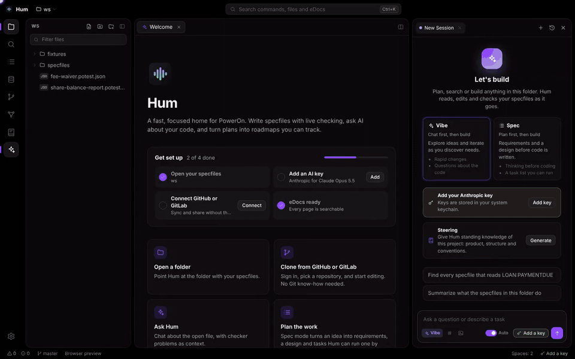
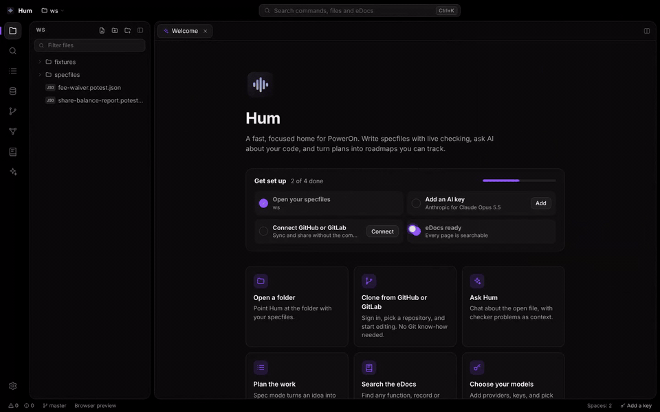
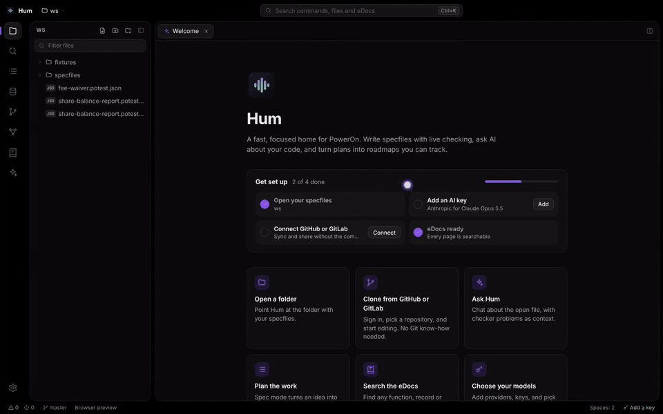
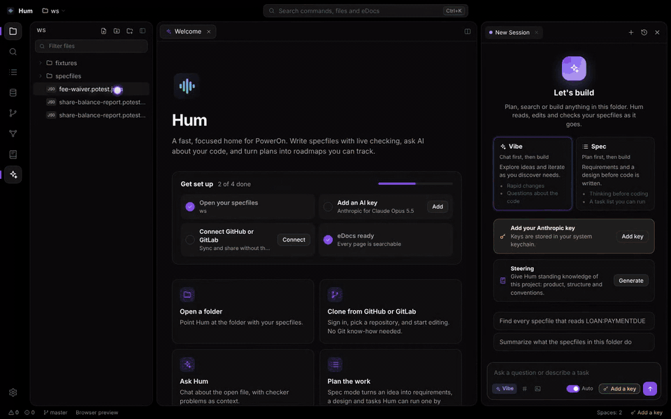
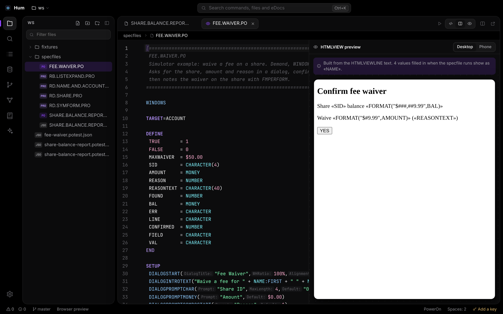
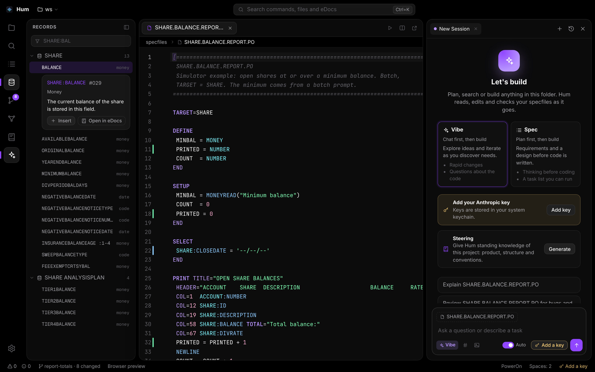
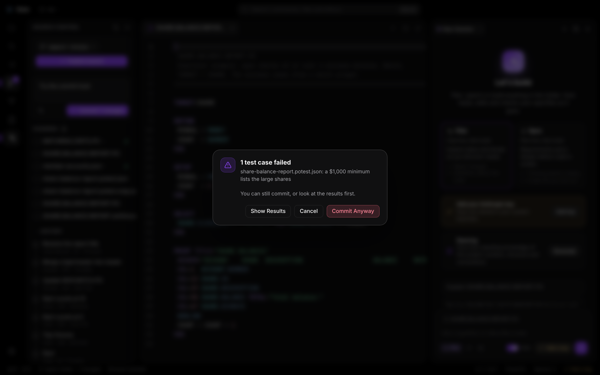
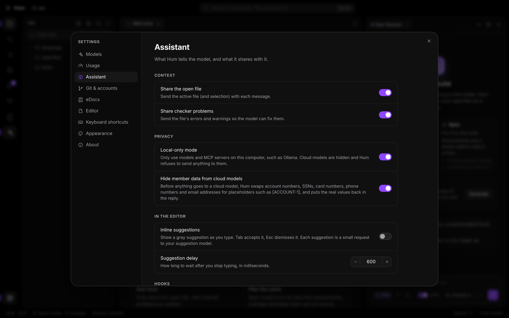
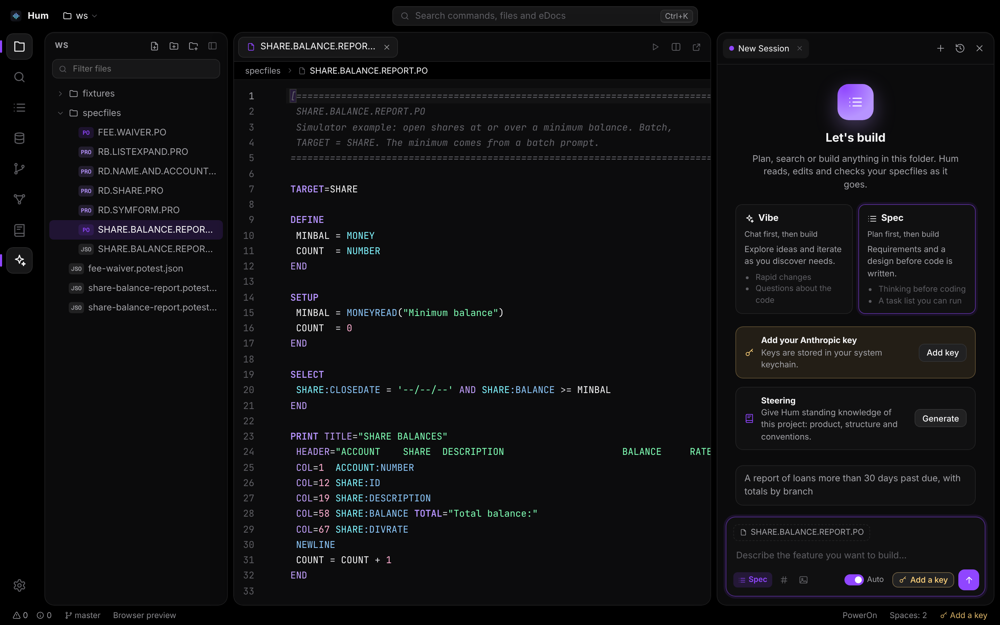
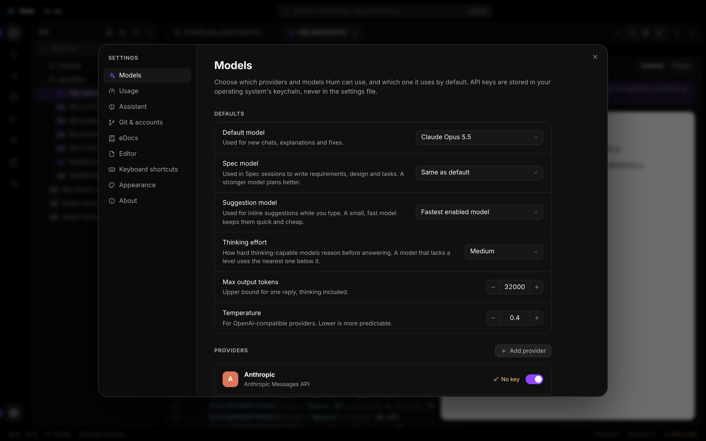

<div align="center">


# Hum

**The modern editor for Symitar PowerOn.**

Live error checking, the full eDocs built in, a local simulator, Git that just works,
and an AI agent that reads, edits and checks your specfiles with you.

[](https://github.com/TylerCodesTech/Hum-releases/releases/latest)


### [Download Hum](https://github.com/TylerCodesTech/Hum-releases/releases/latest)

[Download](#download) · [Why Hum](#why-hum) · [See it in action](#see-it-in-action) · [Features](#features) · [Keyboard shortcuts](#keyboard-shortcuts) · [Help](#help-and-feedback)

<br>


</div>

<br>

## Download

Get the newest installer from the **[latest release](https://github.com/TylerCodesTech/Hum-releases/releases/latest)**.

| Your computer | File to download |
| --- | --- |
| 🍎 Mac (Apple silicon or Intel) | the file ending in `.dmg` |
| 🪟 Windows 10 or 11 | the file ending in `-setup.exe` (or `.msi` for managed installs) |
| 🐧 Linux | `.AppImage` (any distribution), `.deb` (Debian, Ubuntu) or `.rpm` (Fedora, RHEL) |

Once installed, Hum updates itself. You can also check any time in **Settings → About → Check now**.

### Mac with Homebrew

If you use [Homebrew](https://brew.sh), these two commands install Hum and open it without the macOS warning:

```sh
brew tap tylercodestech/hum https://github.com/TylerCodesTech/Hum-releases
brew install --cask hum
```

To remove it later: `brew uninstall --cask hum`.

### The first time you open it

Hum is not yet signed with an Apple or Microsoft certificate, so both systems ask you to confirm once when you install from a downloaded file.

- **macOS**: open Hum, dismiss the warning, then go to **System Settings → Privacy & Security** and choose **Open Anyway**. (Installing with Homebrew skips this.)
- **Windows**: on the "Windows protected your PC" screen choose **More info**, then **Run anyway**.

## Why Hum

PowerOn has no compiler outside the Symitar host, so most editors leave you guessing until you upload.
Hum checks every specfile as you type, puts every eDocs page one keystroke away, and runs your
specfiles in a local simulator, all in a small native app (a few MB, not a bundled browser).

|  |  |
| --- | --- |
| ⚡ **Fast and light** | Native Tauri 2 shell with CodeMirror 6. The checker runs in a few milliseconds per file. |
| 🔎 **Errors before upload** | Hum's own PowerOn checker, with problems labelled *syntax*, *type*, *semantic* or *style*, with quick fixes. |
| 📚 **eDocs inside** | All ~7,000 Symitar eDocs pages ship in the app: hover, completion, search and a full reader. Nothing to install or point at. |
| 🧪 **Run it locally** | A PowerOn simulator with prompts and test data, plus `.potest.json` test suites with snapshots. |
| 🌿 **Git without the Git** | Built in (no install). Diff, commit, branch, sync, and one-click GitHub or GitLab sign-in. |
| ✨ **An AI agent that checks its work** | Bring your own model. Hum reads the checker's results like a developer and iterates on its own edits, on its own branch. |
| 🔌 **Helpful with no model at all** | Ask Hum answers from the eDocs and your code, applies safe fixes, generates tests and writes header docs, all worked out on your computer. |

## See it in action

> Every clip below was recorded from the real app working on sample specfiles.
> Click any clip for the full-quality MP4.

### Write with live checking

Completion for keywords, functions and `RECORD:FIELD` names, a check on every keystroke, and the eDocs entry for any field on hover.

[](docs/readme/write-and-check.mp4)

### The eDocs, one keystroke away

`Ctrl/Cmd+K` searches commands, files and every eDocs page at once. `Tab` completes `SHARE:BAL` to `SHARE:BALANCE`; start with `#` for full-text search.

[](docs/readme/edocs.mp4)

### Run specfiles and tests in the simulator

Press `F5` to run a specfile against local test data. Hum asks the prompts, then shows the report output, the answers and the variables. `.potest.json` suites run the same way.

[](docs/readme/simulator-and-tests.mp4)

### Git, built in

Change markers in the gutter, inline blame, side-by-side diffs and a one-button commit. Sign in to GitHub or GitLab with a browser code, clone, sync and open pull requests from the app.

[](docs/readme/git.mp4)

### Find your way around

Go to any file from the palette, an outline of divisions and procedures, a records and fields browser, and split editors.

[](docs/readme/navigate.mp4)

### Make it yours

More than twenty original Hum themes, light and dark, with accent colours, eight bundled coding fonts, and every shortcut remappable.

[](docs/readme/themes.mp4)

## Features

### Editor

- PowerOn highlighting, completion and signature help, with parameter names shown inline in function calls.
- Live checking with a **Problems** panel for the open file or the whole workspace, plus quick fixes and a formatter.
- Outline, folding, breadcrumbs with sticky division headers, Go to File, Find References, and find and replace across files.
- Tabs, split editors (right or down), and pop-out windows. Files changed on disk reload, and your session comes back after a restart.
- Local history keeps earlier versions of every file you save, so you can compare and restore without Git.
- Snippets, a minimap, pinned and preview tabs, and Compare Files.
- Opens everything else too: Markdown and HTML with live previews, images, and other languages. PowerOn `HTMLVIEW` pages get a preview of their own.

<p align="center">
  
  
</p>

### eDocs

- Every page searchable by name, by `RECORD:FIELD`, or by full text (`@` records, `fn:` functions, `kw:` keywords, `p:` pages, `#` full text).
- A reader with back and forward, a contents sidebar, "On this page", and PowerOn code you can copy or insert.
- Hover any name in the editor, or press `F1` to open its page.

### Simulator and tests

- Run a specfile with `F5`. Prompts are asked in the app; test data comes from a `.simfixture.json` next to the specfile.
- Debug a run: set breakpoints with `F9`, then step over (`F10`), into (`F11`) or out (`Shift+F11`) and watch the variables change.
- `.potest.json` suites with expected output and snapshots, and an optional hook that runs them before every commit.

<p align="center">
  
</p>

### Git, GitHub and GitLab

- libgit2 inside the app, so there is nothing to install. Changes, diffs, staging, branches, history and one-button **Sync**.
- Guided merges: conflicts open in the editor with *Keep mine*, *Keep theirs* or *Keep both*. Switching branches can bring your changes along.
- GitHub and GitLab sign-in with a one-time browser code or an access token. Clone in one step and open pull or merge requests from the app. Tokens stay in the OS keychain.

### Ask Hum, built in (no model)

When AI is off, or on with no model connected yet, the AI chat is hidden and Ask Hum takes its place, so the panel, buttons and commands keep working. Nothing here calls a model or leaves your computer: every answer is computed from the bundled eDocs, the checker, the parser and the files in your folder.

- **Ask in plain words.** "What does CAPITALIZE do?", "share balance", `LOAN:PAYMENTDUE` or "How do I print a subtotal?" return the function, field or eDocs page, with syntax, an example, code values and a link to the source page. "Where is SHARE:BALANCE used?" searches the folder.
- **Fix what is safe.** One click applies only the fixes that cannot change what the code means (a missing `THEN`, tabs, non-ASCII characters, an undeclared variable whose type is clear), re-checks after each pass, and shows the diff with Undo. It will not declare a name that looks like a misspelling of one you already have.
- **Explain.** A division-by-division summary of a specfile (prompts, records read and changed, procedures, includes), a line-by-line reading of the selection, or what a checker problem means and how to fix it.
- **Generate tests.** Simulator test cases from the specfile's own prompts and field references, with sample data and edge-case answers (zero, very large, blank, year end). Each case is tried first, and ones that cannot run are left out.
- **Write header documentation.** A structure section for the header comment, written from the code and proposed in the editor for you to accept or reject. Running it again replaces that section and leaves your own words alone.
- **Suggestions as you type.** Gray text finishes the line, or offers the next one, from patterns in your own specfiles. `Tab` accepts it.

With AI on, the same answers are one click away from the chat header, and **Fix what is safe** sits next to **Fix with AI** in the Problems panel.

> Ask Hum matches names and wording, and reads the structure of your code. It does not write new logic or judge whether logic is right; that is what connecting a model adds.

### AI agent

Hum's agent works in your open folder with tools: it lists, reads and searches files, edits them, runs the PowerOn checker, and reads the eDocs. Every step shows as a card with its diff and checker results.

- **Vibe or Spec.** Chat first and build, or have Hum write requirements, a design and a task list before any code, then run the tasks one by one.
- **Inline edit (`Ctrl/Cmd+I`).** Select code, describe the change, and accept, reject or try again in place.
- **Safe by design.** Every AI change lands on its own `hum/...` branch and is committed step by step, with checkpoints you can restore. Supervised mode makes each change wait for your OK.
- **Your models.** Anthropic, OpenAI, Ollama, LM Studio or any OpenAI-compatible endpoint. Pick a default, a planning model and a fast model for suggestions. Keys live in the OS keychain and are never shown again.
- **Privacy controls.** Local-only mode keeps everything on local models, and member-data redaction swaps account numbers, SSNs, card numbers and contact details for placeholders before anything reaches a cloud model.
- **Steering, hooks and MCP.** Project steering docs, opt-in hooks (check or review on save, tests before commit), and MCP servers for extra tools.

<p align="center">
  
  
</p>

<p align="center">
  
  
</p>

> Connecting to a Symitar host (upload, download, run on the host) is not part of Hum yet. Everything above works on your own machine.

## Keyboard shortcuts

| Action | Shortcut |
| --- | --- |
| Command palette, files and eDocs | `Ctrl/Cmd+K` |
| Search in files | `Ctrl/Cmd+Shift+F` |
| eDocs sidebar | `Ctrl/Cmd+Shift+E` |
| Open the eDocs page for the word at the cursor | `F1` |
| Run in the simulator / run tests | `F5` |
| Toggle a breakpoint | `F9` |
| Step over / into / out | `F10` / `F11` / `Shift+F11` |
| Inline AI edit | `Ctrl/Cmd+I` |
| Show or hide the AI panel | `Ctrl/Cmd+L` |
| Show or hide the sidebar | `Ctrl/Cmd+B` |
| Split editor right | `Ctrl/Cmd+\` |

Every shortcut can be changed in **Settings → Keyboard shortcuts**.

## Help and feedback

Found a problem or have an idea? Open an [issue](https://github.com/TylerCodesTech/Hum-releases/issues). Inside the app, **Help** has a guide to every feature and short demos of the commands.

Every version, with its installers, is on the [Releases](https://github.com/TylerCodesTech/Hum-releases/releases) page.

<div align="center">
<br>
<sub>Built for credit-union PowerOn developers on macOS, Windows and Linux.</sub>
</div>
